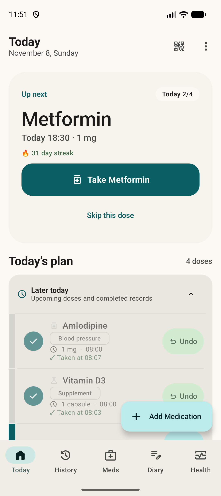
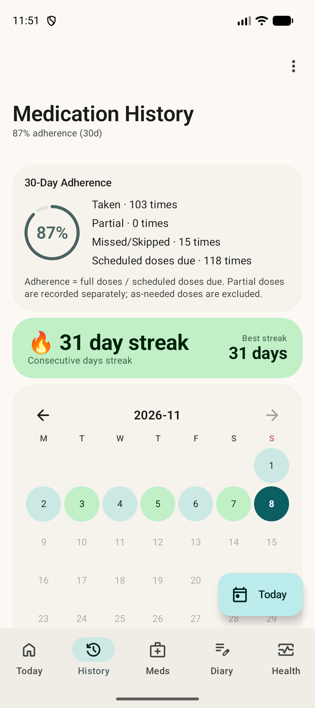
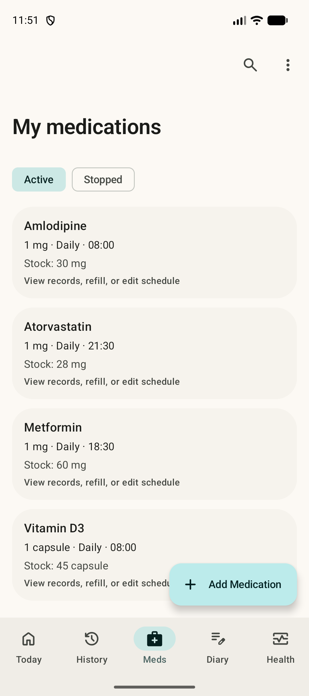
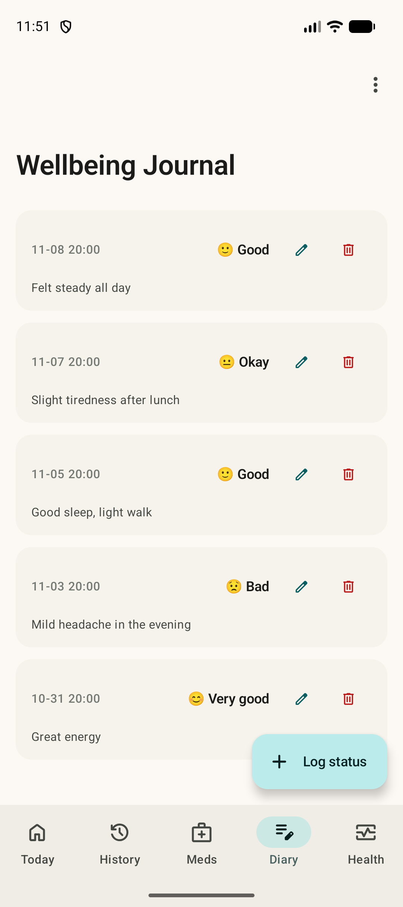
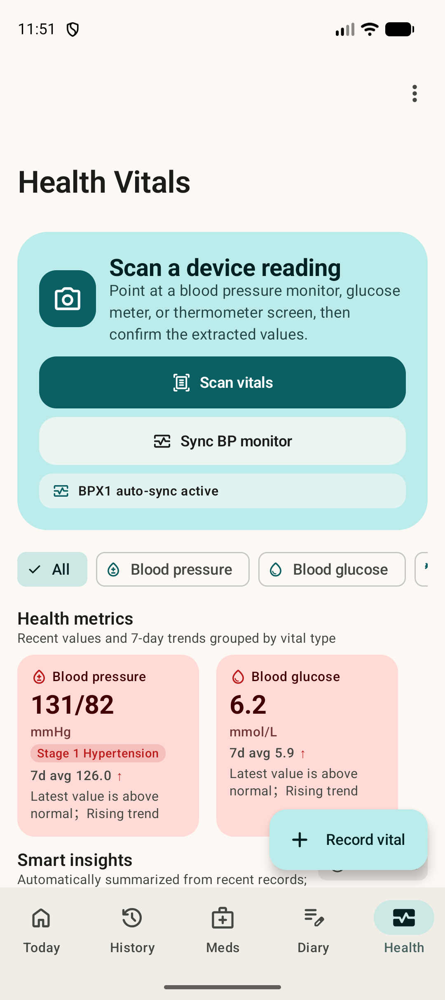

# Anshin 安心

<p align="center">
  <strong>A personal medication tracker that follows your daily rhythm.</strong><br>
  <em>安心 · 安心 · 안심 — Peace of mind, in every dose.</em>
</p>

<p align="center">
  <a href="https://github.com/Tinnci/anshin/actions/workflows/build.yml">
    
  </a>
  <a href="https://github.com/Tinnci/anshin/releases/latest">
    
  </a>
  
  
  
</p>

<p align="center">
  
  
  
  
  
</p>

A native Android app built with **Kotlin · Jetpack Compose · Material 3 Expressive** that helps you
take the right dose at the right time, keep stock in check, and track vitals in one place.

## Features

- **Today** — an "Up next" hero, grouped daily plan, one-tap Take / Skip / Undo, and streaks.
- **Precise reminders** — exact alarms with Taken / Skip actions in the notification, restored after reboot.
- **Flexible schedules** — exact times or fuzzy periods (after breakfast, bedtime…), PRN doses, travel-mode time zones.
- **History** — 30-day adherence, streaks, and a calendar heatmap.
- **Medications** — dose, form, category, stock and refill alerts, a 7,000+ drug catalog, and interaction checks.
- **Health vitals** — blood pressure, glucose, weight and more with trends and on-device smart insights.
- **Device readings** — scan monitor screens with OCR, or auto-sync a BPX1 blood pressure monitor over Bluetooth.
- **Wellbeing journal** — daily mood, symptom and side-effect notes.
- **Share & backup** — QR export/import of plans, homescreen widgets, adaptive phone/tablet layouts.
- **Languages** — English, 中文, 日本語, 한국어.

## Getting Started

Requires JDK 17+ (CI uses 21) and Android SDK 37.

```bash
git clone https://github.com/Tinnci/anshin.git
cd anshin
./gradlew installDebug      # build and install on a device/emulator
./gradlew test              # unit tests
./gradlew ktlintCheck lintDebug
```

Release signing and tagging are documented in [docs/releasing.md](docs/releasing.md).
Pushing a `vX.Y.Z` tag from `main` triggers the signed release workflow.

## Architecture

Modular monolith with MVVM + UDF and a single source of truth: Room and DataStore are durable truth;
alarms, notifications and widgets are rebuilt from them.

```
:app ─┬─ :feature:onboarding
      ├─ :capability:reminders
      ├─ :core:model · :core:database · :core:preferences · :core:ui
```

See [Architecture governance](docs/architecture-governance.md) for boundaries and verification gates, and
[Medication daily flow](docs/medication-daily-flow.md) for scheduling and dose records.

## Contributing

Fork → feature branch → PR. Run `ktlintCheck` and `lintDebug` first, follow the existing architecture,
and add tests for new domain or ViewModel logic. Translations are welcome via
`app/src/main/res/values-{lang}/`.

## License

Apache License 2.0 — see https://www.apache.org/licenses/LICENSE-2.0.
